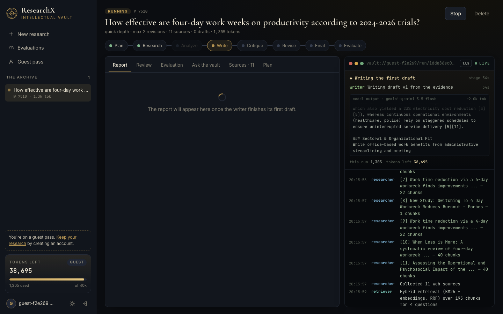
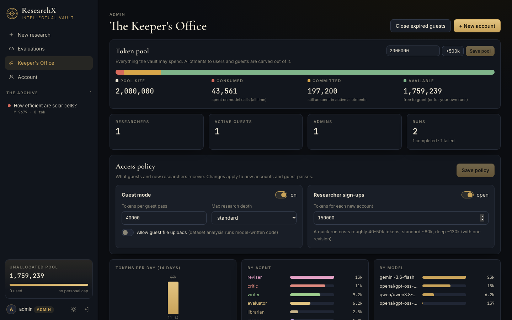

<div align="center">

#  ResearchX

**A  full-stack autonomous research platform powered by LangChain + LangGraph.**
Runs entirely on **free LLM APIs** — plans, searches, retrieves, analyzes, writes, critiques, and revises until the report passes peer review.

<br/>

[](https://github.com/your-username/Research_Agent/actions)
[](https://research-agent-tau-red.vercel.app)
[](https://langchain-ai.github.io/langgraph/)
[](https://react.dev)
[](https://fastapi.tiangolo.com)
[](LICENSE)

</div>

---


---

## Table of Contents

- [How it works](#how-it-works)
- [Features](#features)
- [Tech stack](#tech-stack)
- [Quick start](#quick-start)
- [Configuration](#configuration-backendenv)
- [Deployment](#deployment-ec2--vercel)
- [Project layout](#project-layout)
- [Evaluation metrics](#evaluation-metrics)
- [Screenshots](#screenshots)
- [Troubleshooting](#troubleshooting)

---

## How it works

```
           ┌──────────┐   ┌────────────┐   ┌──────────┐   ┌────────┐   ┌──────────┐  pass   ┌──────────┐
question → │ Planner  │ → │ Researcher │ → │ Analyst  │ → │ Writer │ → │  Critic  │ ──────→ │ Finalize │ → Evaluator
           └──────────┘   └────────────┘   └──────────┘   └────────┘   └──────────┘         └──────────┘
                                                           (if data)      │    ▲
                                                                   revise │    │ re-score
                                                                          ▼    │
                                                               ┌──────────────┐ ┌─────────┐
                                                               │ Gap research │→│ Reviser │
                                                               └──────────────┘ └─────────┘
```

1. **Planner** decomposes the question into sub-questions and a search strategy.
2. **Researcher** fetches web pages and PDFs, extracts clean text, and builds a hybrid RAG index (BM25 + dense vectors, fused with Reciprocal Rank Fusion).
3. **Analyst** *(if datasets are uploaded)* profiles the data and executes LLM-generated Python to produce charts and statistics.
4. **Writer** produces a cited, structured report grounded in the retrieved sources.
5. **Critic** scores the draft 0–10 against faithfulness, coverage and citation quality.
6. If the score is below `PASS_SCORE`, **Gap Researcher** fills missing evidence and **Reviser** rewrites the report. This loop repeats up to `MAX_REVISIONS` times.
7. **Evaluator** grades the finished run with 15 RAG + agent metrics using LLM-as-judge and deterministic checks.

Crashed, cancelled, or server-restarted runs **resume from their last checkpoint** via an `AsyncSqliteSaver` (`data/checkpoints.db`).

---

## Features

| Category | Details |
|---|---|
| 🤖 **Multi-agent orchestration** | LangGraph `StateGraph` with cyclic critique→revise loop, conditional routing, async execution |
| 🔍 **Hybrid RAG** | BM25 + dense vector search fused with Reciprocal Rank Fusion (RRF) |
| 🌐 **Web research** | DuckDuckGo / Bing / Brave metasearch (or Tavily), with HTML + PDF extraction |
| 📊 **Dataset analysis** | Upload CSV / XLSX / JSON — LLM writes and executes Python, produces matplotlib charts |
| 📝 **Self-critique loop** | Critic scores drafts; Reviser rewrites until score ≥ `PASS_SCORE` or revision limit hit |
| 📈 **Self-evaluation** | 15 metrics: faithfulness, context precision, nDCG, MRR, hallucination rate, citation precision, and more |
| 💬 **Follow-up Q&A** | Ask the vault — hybrid RAG Q&A on a finished run's indexed sources, with citations |
| 🔴 **Live terminal** | SSE stream: current stage, agent, action, tokens used, model output as it generates |
| 👥 **Multi-user auth** | Admin / Researcher / Guest roles, session cookies, token pool managed by admin |
| ♻️ **Resumable runs** | SQLite checkpointing — runs survive crashes, cancellations and server restarts |
| 🚀 **Free to run** | Groq + Gemini free tiers cover typical research runs with no credit card |

---

## Tech stack

| Layer | Technology |
|---|---|
| **Orchestration** | LangGraph 1.x (`StateGraph`, `AsyncSqliteSaver`) |
| **LLM access** | LangChain — Groq, Google Generative AI, OpenRouter (via LangChain-OpenAI), Ollama |
| **Embeddings** | Gemini `gemini-embedding-001` (falls back to local hash when no key) |
| **RAG** | BM25 (rank-bm25), dense vectors, Reciprocal Rank Fusion |
| **Web scraping** | `trafilatura`, `beautifulsoup4`, `pypdf`, `ddgs` (DuckDuckGo) / Tavily |
| **Data analysis** | `pandas`, `numpy`, `matplotlib`, `openpyxl` |
| **API** | FastAPI + Uvicorn, SSE for live streaming |
| **Database** | SQLite (`aiosqlite`) — users, sessions, runs, events, token ledger, RAG chunks |
| **Frontend** | React 18, Vite 5, `react-markdown` + `remark-gfm` |
| **Deployment** | Docker + Docker Compose (EC2), Vercel (frontend), GitHub Actions CI/CD |

---

## Quick start

### Prerequisites

- **Python 3.11+**
- **Node 18+**
- At least one free API key → [Groq](https://console.groq.com/keys) or [Gemini](https://aistudio.google.com/apikey)

### 1. Clone & start

```bash
git clone https://github.com/your-username/Research_Agent.git
cd Research_Agent
./start.sh
```

`start.sh` will:
- Create a Python virtual environment and install all dependencies
- Copy `backend/.env.example` → `backend/.env` on first run
- Start the FastAPI backend and the Vite dev server
- Wait until the backend is healthy before opening the UI

> **First start takes 30–60 s** while Python compiles LangChain. Subsequent starts are instant.

### 2. Add your API key

Open `backend/.env` and add at least one:

```env
GROQ_API_KEY=gsk_...        # https://console.groq.com/keys  (free)
GEMINI_API_KEY=AIza...      # https://aistudio.google.com/apikey  (free)
ADMIN_PASSWORD=your_strong_password
```

Then re-run `./start.sh`.

### 3. Open the app

```
http://localhost:5173
```

### Custom ports

```bash
BACKEND_PORT=8001 FRONTEND_PORT=5174 ./start.sh
```

### Sign in

| Role | How |
|---|---|
| **Admin** | Keeper's Office → sign in with `ADMIN_USERNAME` / `ADMIN_PASSWORD` from `backend/.env` |
| **Researcher** | Reading Room → **Create account** (username 3–32 chars, password 8+) |
| **Guest** | Reading Room → **Continue as guest** (no password, limited tokens) |

---

## Configuration (`backend/.env`)

Copy `backend/.env.example` to `backend/.env` and fill in the values you need.

### LLM providers *(set at least one)*

| Variable | Where to get it |
|---|---|
| `GROQ_API_KEY` | https://console.groq.com/keys |
| `GEMINI_API_KEY` | https://aistudio.google.com/apikey |
| `OPENROUTER_API_KEY` | https://openrouter.ai/keys — use `:free` model suffixes |
| `OLLAMA_BASE_URL` | `http://localhost:11434` if Ollama is running locally |

### Model routing

Each role uses a comma-separated **fallback chain** (`provider:model`). Providers without a configured key are automatically skipped.

```env
MODEL_PLANNER=groq:llama-3.3-70b-versatile,gemini:gemini-2.5-flash
MODEL_FAST=groq:llama-3.1-8b-instant,gemini:gemini-2.5-flash-lite
MODEL_WRITER=gemini:gemini-2.5-flash,groq:llama-3.3-70b-versatile
MODEL_CRITIC=groq:llama-3.3-70b-versatile,gemini:gemini-2.5-flash
MODEL_ANALYST=groq:llama-3.3-70b-versatile,gemini:gemini-2.5-flash
MODEL_JUDGE=groq:llama-3.1-8b-instant,gemini:gemini-2.5-flash-lite
EMBEDDING_MODEL=gemini-embedding-001
```

### Orchestration

```env
MAX_REVISIONS=2            # maximum critique→revise cycles
PASS_SCORE=8.0             # critic score (out of 10) to exit the loop early
SEARCH_RESULTS_PER_QUERY=5
MAX_SOURCES=18
```

### Auth

```env
ADMIN_USERNAME=admin
ADMIN_PASSWORD=changeme    # generated and printed if left blank on first start
SESSION_DAYS=14
GUEST_HOURS=24
GUESTS_PER_IP_PER_DAY=5
COOKIE_SECURE=false        # set true when served over HTTPS in production
```

### Production / CORS

```env
DATA_DIR=/data             # where SQLite DBs, uploads and charts are stored (Docker default: /data)
SECRET_KEY=                # openssl rand -hex 32  — stable key for signing stream tokens
CORS_ORIGINS=https://your-app.vercel.app   # comma-separated; * allows all origins
CORS_API_ORIGINS=https://your-app.vercel.app
TRUST_PROXY=false          # set true behind Vercel + Cloudflare (uses X-Forwarded-For for IP limits)
```

### Search *(optional)*

```env
TAVILY_API_KEY=            # https://tavily.com — improves search quality; falls back to DuckDuckGo if blank
```

---

## Data storage

All persistent data lives under `DATA_DIR` (default: `backend/data/`):

```
backend/data/
├── researchx.db       ← SQLite: users, sessions, runs, events, RAG chunks, token ledger
├── checkpoints.db     ← LangGraph checkpoints for resumable runs
├── uploads/           ← user-uploaded datasets and documents (per-run subdirectory)
└── outputs/           ← generated reports and matplotlib charts (per-run subdirectory)
```

> [!TIP]
> On EC2, set `DATA_DIR` to a path on an **EBS volume** so your data survives instance restarts.

---

## Deployment (EC2 + Vercel)

The recommended production setup:

```
GitHub Actions CI/CD
       │
       ├─ tests (pytest)
       ├─ Docker image → GHCR
       ├─ SSH → EC2 (docker-compose pull + up)   ← Backend + SQLite
       ├─ Health check through Cloudflare Tunnel
       └─ Vercel deploy                           ← Frontend (static + CDN)
```

**Full setup guide:** [docs/DEPLOYMENT.md](docs/DEPLOYMENT.md)  
**All secrets & variables:** [docs/ENVIRONMENT.md](docs/ENVIRONMENT.md)

### Key environment variables for split deployment

**Vercel** (frontend build env):
```
VITE_API_URL=https://your-ec2-backend.com
```

**EC2 backend** (`backend/.env`):
```env
CORS_ORIGINS=https://your-app.vercel.app
COOKIE_SECURE=true
SECRET_KEY=<openssl rand -hex 32>
TRUST_PROXY=true
```

> [!IMPORTANT]
> `VITE_API_URL` is **baked into the JS bundle at build time** by Vite. After changing it in Vercel's dashboard you must trigger a new deployment.

### Single-process mode (one server)

```bash
cd frontend && npm run build
cd ../backend && .venv/bin/uvicorn app.main:app
# UI + API together at http://localhost:8000
```

### Run tests locally

```bash
cd backend
.venv/bin/pip install -r requirements-dev.txt
.venv/bin/python -m pytest -q tests/
```

---

## Project layout

```
Research_Agent/
├── backend/
│   ├── app/
│   │   ├── main.py          FastAPI: auth, runs, SSE events, evaluations, admin API, file serving
│   │   ├── auth.py          accounts, sessions, roles, token pool accounting
│   │   ├── config.py        env-var loading, path constants, CORS/cookie settings
│   │   ├── orchestrator.py  LangGraph StateGraph + SQLite checkpointer, run lifecycle
│   │   ├── agents.py        planner · researcher · analyst · writer · critic · reviser · evaluator · librarian
│   │   ├── llm.py           LangChain chains with fallbacks + rate limiting, JSON repair, embeddings
│   │   ├── rag.py           text splitting, BM25, dense vectors, RRF, HybridRetriever
│   │   ├── search.py        web search + HTML/PDF extraction
│   │   ├── analysis.py      dataset profiling + LLM-generated code execution
│   │   ├── evals.py         RAG + agent evaluation metrics (LLM-as-judge + deterministic)
│   │   ├── meter.py         per-run token metering + live "doing right now" state
│   │   └── db.py            SQLite helpers: runs, events, chunks, users, token ledger
│   ├── data/                runtime data (gitignored) — DBs, uploads, outputs
│   ├── tests/               pytest API test suite
│   ├── Dockerfile           production image
│   ├── requirements.txt
│   └── .env.example         annotated config template
├── frontend/
│   └── src/
│       ├── App.jsx          shell, auth gate, routing
│       ├── Landing.jsx      login / sign-up / guest entry
│       ├── Composer.jsx     new-run form (question, depth, file uploads)
│       ├── RunView.jsx      live terminal, evaluation panel, follow-up Q&A
│       ├── Evals.jsx        evaluations dashboard
│       ├── Admin.jsx        Keeper's Office (users, token pool, settings)
│       ├── Account.jsx      account & password management
│       ├── api.js           typed fetch client (uses VITE_API_URL in production)
│       └── ui.jsx           shared UI primitives
├── deploy/
│   ├── docker-compose.yml   EC2 production stack
│   ├── ec2-setup.sh         one-shot EC2 bootstrapper (Docker, Cloudflare Tunnel, systemd)
│   └── render-vercel-json.sh  generates vercel.json from env vars
├── docs/
│   ├── API.md               full HTTP API reference
│   ├── CODEBASE.md          file-by-file and function-by-function guide
│   ├── DEPLOYMENT.md        step-by-step EC2 + Vercel + GitHub Actions setup
│   └── ENVIRONMENT.md       every secret/variable with how to obtain it
├── start.sh                 local dev launcher (venv + both servers)
└── .github/workflows/       ci-cd.yml — test → build → deploy pipeline
```

---

## Evaluation metrics

After a run completes, the **Evaluator agent** grades it using a separate model family (to stay independent of the writer).

### RAG metrics

| Metric | Method |
|---|---|
| **Faithfulness / hallucination rate** | Up to 12 cited claims sampled and checked against their cited source chunks |
| **Context precision, nDCG, MRR** | LLM judge grades each retrieved chunk 0/1/2; ranking metrics use those labels |
| **Answer relevance** | Judge rates how directly the report answers the original question |
| **Sub-question coverage** | Judge rates whether each planned sub-question was answered |
| **Citation precision / coverage** | Deterministic checks on citation counts in the final report |
| **Ranker agreement** | Jaccard overlap of BM25 vs dense top-k (low = complementary rankers = hybrid fusion helps) |

### Agent metrics

Drawn from the token ledger and event log: calls, tokens, latency and fallback rate per agent; wall time per stage; planner query diversity; researcher yield; critic → reviser score trajectory.

### Overall grade

$$\text{Overall} = 35\%\ \text{faithfulness} + 20\%\ \text{context precision} + 20\%\ \text{answer relevance} + 15\%\ \text{critic score} + 10\%\ \text{citation precision}$$

---

## Screenshots

| Live agent terminal | Run evaluation |
|---|---|
|  |  |
| **Keeper's Office (admin)** | **Evaluations dashboard** |
|  |  |

A parchment light theme is one click away: [report view](docs/screenshots/report-light.png).

---

## Troubleshooting

| Symptom | Cause & fix |
|---|---|
| Red **"Can't reach the backend"** banner | The UI is up but the API isn't. Run `./start.sh` or start the API manually: `cd backend && .venv/bin/uvicorn app.main:app --port 8000`. The page reconnects automatically. |
| `start.sh` → "Port 8000 is already in use" | An old backend process holds the port. `kill <PID>` from the message, or `BACKEND_PORT=8001 ./start.sh`. |
| `start.sh` → "The backend exited during startup" | Check the last lines of `backend/data/backend.log` — usually a missing dependency (delete `backend/.venv` and re-run) or a bad value in `.env`. |
| **CORS error** in browser console | `CORS_ORIGINS` in `backend/.env` doesn't include your Vercel URL. Set `CORS_ORIGINS=https://your-app.vercel.app` and restart the backend. |
| Requests still hit `frontend-url/api/…` instead of EC2 | `VITE_API_URL` is baked at build time. Set it in Vercel → Settings → Environment Variables, then **redeploy**. |
| "Create account" says sign-ups are closed | Admin turned sign-ups off in Keeper's Office → Access policy. Admin can reopen them or create the account. |
| A run is `paused` | The owner ran out of tokens. Admin tops up the account in Keeper's Office; then press **Resume**. |
| "No LLM provider configured" | Add at least one key (`GROQ_API_KEY` / `GEMINI_API_KEY`) to `backend/.env` and restart. |
| A provider returns 404 for a model | Free models get retired. Update the `MODEL_<ROLE>` chains in `backend/.env` with current model names. |
| Cookies not sent in production | Ensure `COOKIE_SECURE=true` in backend `.env` and that your EC2 backend is served over **HTTPS**. `SameSite=None` cookies require a secure context. |

---

## Free API keys

| Provider | Link | Notes |
|---|---|---|
| Groq | https://console.groq.com/keys | Fast inference, generous free tier |
| Gemini | https://aistudio.google.com/apikey | Also provides embeddings |
| OpenRouter | https://openrouter.ai/keys | Use `:free` model suffixes |
| Tavily | https://tavily.com | Optional — improves search quality |

---

## Documentation

| Doc | Contents |
|---|---|
| [docs/API.md](docs/API.md) | Full HTTP API reference (every endpoint, method, body, response) |
| [docs/CODEBASE.md](docs/CODEBASE.md) | File-by-file and function-by-function guide for contributors |
| [docs/DEPLOYMENT.md](docs/DEPLOYMENT.md) | Step-by-step EC2 + Cloudflare + Vercel + GitHub Actions setup |
| [docs/ENVIRONMENT.md](docs/ENVIRONMENT.md) | Every secret/variable with how to obtain and set it |

---

> [!WARNING]
> The dataset analysis step runs **LLM-generated Python** on your machine. A filter blocks obviously dangerous calls, but this is **not** a security sandbox. Only use it locally with data you trust.
