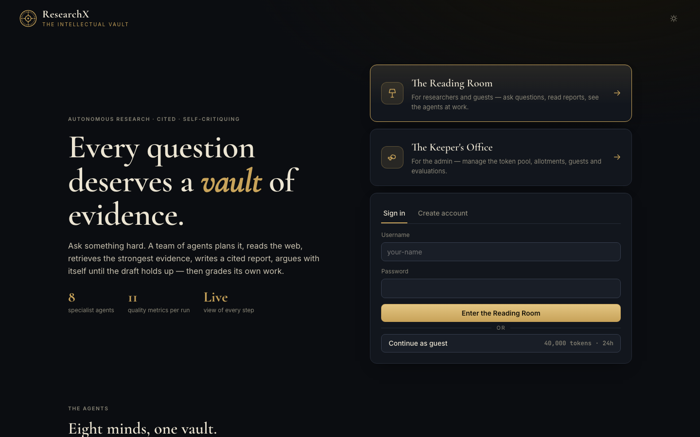
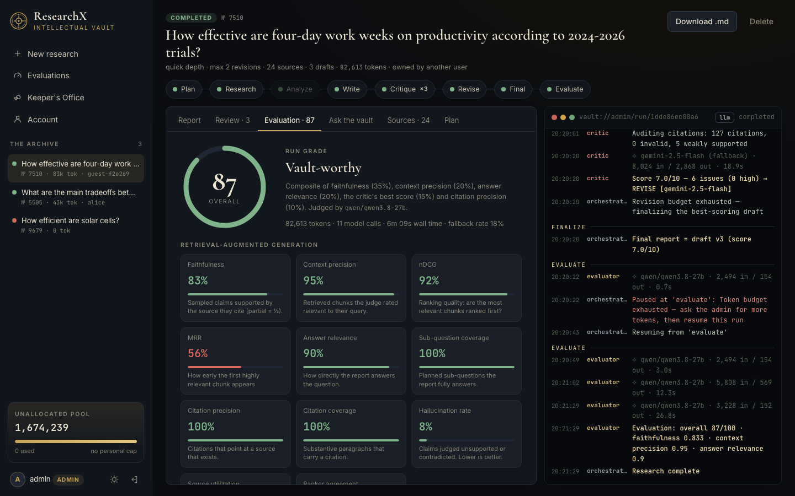
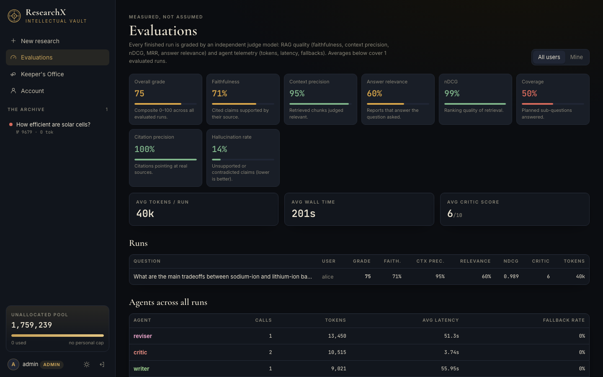

# ResearchX

A local, full-stack autonomous research platform built on **LangChain + LangGraph**. It runs entirely on
**free LLM APIs** (Groq, Gemini, OpenRouter `:free` models, or local Ollama). It plans a research question,
searches the web, builds a hybrid RAG index, analyzes your datasets, writes a cited report, critiques
that report, and revises it until it passes review — then **grades its own run** with RAG and agent
evaluation metrics. It has accounts (admin / researcher / guest), a token pool the admin hands out, a live
terminal showing what each agent is doing, and an "Intellectual Vault" UI.



```
           ┌──────────┐   ┌───────────┐   ┌──────────┐   ┌────────┐   ┌──────────┐  pass   ┌──────────┐
question → │ Planner  │ → │ Researcher│ → │ Analyst  │ → │ Writer │ → │  Critic  │ ──────→ │ Finalize │ → Evaluator
           └──────────┘   └───────────┘   └──────────┘   └────────┘   └──────────┘         └──────────┘
                                                          (if data)      │    ▲
                                                                  revise │    │ re-score
                                                                         ▼    │
                                                              ┌──────────────┐ ┌─────────┐
                                                              │ Gap research │→│ Reviser │
                                                              └──────────────┘ └─────────┘
```

## Quick start

```bash
./start.sh            # first run creates venv, installs deps, copies backend/.env
# add at least one key to backend/.env (and ADMIN_PASSWORD), then re-run ./start.sh
open http://localhost:5173
```

Requirements: Python 3.11+ and Node 18+. `start.sh` waits until the backend answers before starting the UI;
the very first start takes 30–60 s while Python compiles LangChain. Ports are configurable:
`BACKEND_PORT=8001 FRONTEND_PORT=5174 ./start.sh`.

- **Admin:** open the Keeper's Office and sign in with `ADMIN_USERNAME` / `ADMIN_PASSWORD` from `backend/.env`
  (if `ADMIN_PASSWORD` is blank on first start, a password is generated and printed by `start.sh`).
- **Researchers:** open the Reading Room → **Create account** (username 3–32 chars, password 8+), or ask the admin
  to create an account in the Keeper's Office.
- **Guests:** Reading Room → **Continue as guest** (no password).

New to the code? See **[docs/CODEBASE.md](docs/CODEBASE.md)** (every file and function) and
**[docs/API.md](docs/API.md)** (every endpoint).

Free keys: **Groq** → https://console.groq.com/keys · **Gemini** → https://aistudio.google.com/apikey ·
(optional) **OpenRouter** → https://openrouter.ai/keys · (optional) **Tavily** search → https://tavily.com

Single-process mode: `cd frontend && npm run build`, then `cd backend && .venv/bin/uvicorn app.main:app`
serves the UI and the API together at http://localhost:8000.

## Screenshots

| Live agent terminal | Run evaluation |
|---|---|
|  |  |
| **Keeper's Office (admin)** | **Evaluations dashboard** |
|  |  |

A parchment light theme is one click away: [report view](docs/screenshots/report-light.png).

## How it works

| Piece | Implementation |
|---|---|
| **Orchestration** | LangGraph `StateGraph` with a cyclic critique→revise loop, conditional routing, and an `AsyncSqliteSaver` checkpointer (`data/checkpoints.db`). Crashed, cancelled or server-restarted runs **resume from the exact node** they stopped at. |
| **Multiple LLMs** | Each role (planner / writer / critic / analyst / fast) has a fallback chain built with `ChatGroq`, `ChatGoogleGenerativeAI` or `ChatOpenAI` (OpenRouter/Ollama) `.with_fallbacks()`. Each model has `max_retries` and a per-provider `InMemoryRateLimiter` so it stays within free-tier limits. By default the critic is a **different model family** from the writer, for an independent review. |
| **Web search** | Tavily (if a key is set), otherwise the `ddgs` metasearch, which tries DuckDuckGo → Bing → Brave → Mojeek → Yahoo, then Wikipedia. Pages are extracted with trafilatura; PDFs with pypdf. |
| **Hybrid RAG** | `RecursiveCharacterTextSplitter` chunks → stored in SQLite with Gemini embeddings (`GoogleGenerativeAIEmbeddings`). A custom LangChain `BaseRetriever` fuses **BM25 + dense cosine** rankings with Reciprocal Rank Fusion and caps chunks per source for diversity. Without a Gemini key it falls back to local hashed n-gram vectors. |
| **Data analysis** | Upload CSV/XLSX/JSON. The analyst LLM writes pandas/matplotlib code, which runs in a subprocess with a timeout. If the code fails, the traceback goes back to the model to repair it (up to 3 attempts). The charts are embedded in the report. |
| **Self-critique** | The critic scores accuracy, evidence support, completeness, balance and clarity, and lists issues with fixes. A deterministic **citation audit** runs alongside it: it flags citations that point to sources that don't exist (these cost points), paragraphs with no citation, and sentences that share few words with the source they cite. |
| **Auto-revision** | If a draft fails review, the critic's follow-up queries trigger more research. The reviser then rewrites the draft against the new evidence, and the critic scores it again. The loop ends when a draft passes or the revision budget runs out; the **best-scoring draft** is kept. |
| **UI** | React + Vite. A live agent log over SSE, a pipeline view, the report with clickable citations, a review tab with score bars, the audit and the reviser's changes, plus sources, analysis code/output/charts, the plan and the models used. |

## Accounts, tokens and guest mode

Open http://localhost:5173 (dev) or http://localhost:8000 (single process). The landing page has two entrances:
**the Reading Room** (researchers and guests) and **the Keeper's Office** (admin).

- **Admin**: created on first start from `ADMIN_USERNAME` / `ADMIN_PASSWORD` in `backend/.env` (a password is
  generated and logged if you leave it blank). The Keeper's Office sets the **token pool**, the allotment for
  new accounts and guest passes, guest depth/upload limits, and lets you top up, disable or delete any account.
- **Researchers**: sign up (if open) or are created by the admin. Each has a token allotment.
- **Guests**: one click, no password, a time-limited pass (`GUEST_HOURS`, default 24h) with the guest allotment.
  A guest can upgrade to an account and keep their runs.

Every model call is metered from the provider's usage data and written to a token ledger. The pool can never be
over-committed: `available = pool − consumed − still-unspent allotments`, and grants must fit in `available`.
A run that runs out of tokens **pauses** (it doesn't fail) and resumes from the same step after a top-up.
Sessions are httpOnly cookies; passwords are PBKDF2-SHA256.

## Evaluation metrics

After the final report, an **Evaluator** node grades the run (older runs can be evaluated from the Evaluations
page). LLM-as-judge calls use the `judge` role, which defaults to a different model family than the writer.

| RAG metric | How |
|---|---|
| Faithfulness / hallucination rate | Up to 12 cited claims are sampled and checked against the best-matching chunks of the source they cite |
| Context precision, nDCG, MRR | The judge grades every retrieved chunk 0/1/2 for its query; ranking metrics use those graded labels |
| Answer relevance, sub-question coverage | The judge rates how directly the report answers the question and each planned sub-question |
| Citation precision / coverage, source utilization | Deterministic checks on the final report |
| Ranker agreement | Jaccard overlap of BM25 vs dense top-k (low = complementary rankers, so the hybrid fusion helps) |

Agent metrics come from the token ledger and event log: calls, tokens, latency and fallback rate per agent,
wall time per stage, planner query diversity, researcher yield, and the critic → reviser score trajectory.
An overall 0–100 grade combines faithfulness (35%), context precision (20%), answer relevance (20%), the critic's
best score (15%) and citation precision (10%).

## Live terminal and follow-up questions

The run page streams a terminal over SSE: the current stage, agent, action and detail (e.g. which query or page),
elapsed time, the model's output **as it is generated**, tokens spent on the run and tokens left. Model calls are
logged with model, tokens in/out and latency. **Ask the vault** answers follow-up questions about a finished run
from its indexed sources (hybrid RAG, cited), without new web research.

## Troubleshooting

| Symptom | Cause and fix |
|---|---|
| Red "Can't reach the backend" banner, or `Internal Server Error` / `502` on every action | The UI (Vite, :5173) is up but the API (:8000) isn't. Run `./start.sh` (it starts both), or start the API yourself: `cd backend && .venv/bin/uvicorn app.main:app --port 8000`. The page reconnects by itself once the API answers. |
| `start.sh` says "Port 8000 is already in use" | Another process (often an old backend) holds the port. Stop it (`kill <PID>` from the message) or use `BACKEND_PORT=8001 ./start.sh`. |
| `start.sh` says "The backend exited during startup" | It prints the last lines of `backend/data/backend.log` — usually a missing dependency (delete `backend/.venv` and re-run) or a bad value in `.env`. |
| "Create account" says sign-ups are closed | The admin turned sign-ups off in the Keeper's Office → Access policy. The admin can reopen them or create the account. |
| A run is `paused` | The owner ran out of tokens. The admin tops up the account; then press **Resume**. |
| "No LLM provider configured" | Add at least one key (`GROQ_API_KEY` / `GEMINI_API_KEY`) to `backend/.env` and restart. |
| A provider returns 404 for a model | Free models get retired; update the `MODEL_<ROLE>` chains in `backend/.env`. |

## Configuration (`backend/.env`)

- `MODEL_<ROLE>` (planner, fast, writer, critic, analyst, judge): comma-separated fallback chain of `provider:model`.
  Providers without a key are skipped.
  Free model names change over time; update these if a provider retires a model.
- `MAX_REVISIONS`, `PASS_SCORE` (default 8.0/10), `SEARCH_RESULTS_PER_QUERY`, `MAX_SOURCES`.

## Project layout

```
backend/app/
  main.py          FastAPI: auth, runs, SSE (events + live state), evaluations, admin API, file serving
  auth.py          accounts, sessions, roles, token pool accounting
  meter.py         per-run token metering + the live "doing right now" state
  evals.py         RAG + agent evaluation metrics (LLM-as-judge + deterministic)
  orchestrator.py  LangGraph StateGraph + SQLite checkpointer
  agents.py        planner, researcher, analyst, writer, critic, gap-research, reviser, finalize, evaluate, librarian
  llm.py           LangChain model chains with fallbacks + rate limiting, JSON repair, embeddings
  rag.py           text splitting, BM25, dense vectors, RRF, HybridRetriever
  search.py        web search + page/PDF extraction
  analysis.py      dataset profiling + LLM-written code execution
  db.py            SQLite: runs, events, chunks
frontend/src/      React UI: Landing, App shell, Composer, RunView (terminal, evaluation, ask), Evals, Admin, Account
docs/CODEBASE.md   what every file and function does
docs/API.md        HTTP API reference
```

> ⚠️ The analysis step runs LLM-generated Python on your machine. A simple filter blocks obvious dangerous
> calls, but this is **not** a security sandbox. Only use it locally with data you trust.
